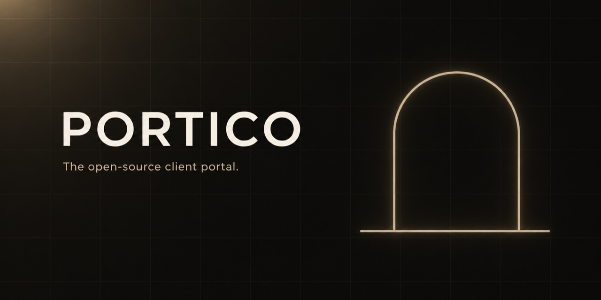
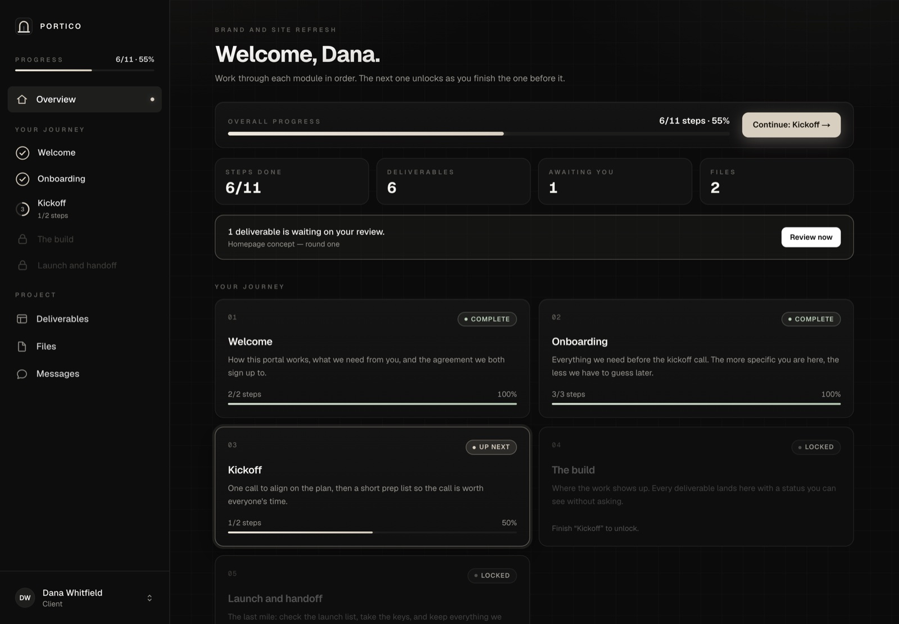
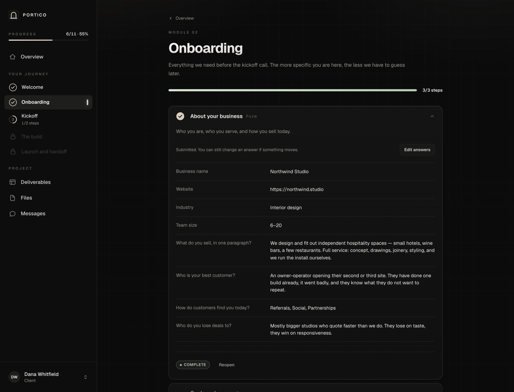
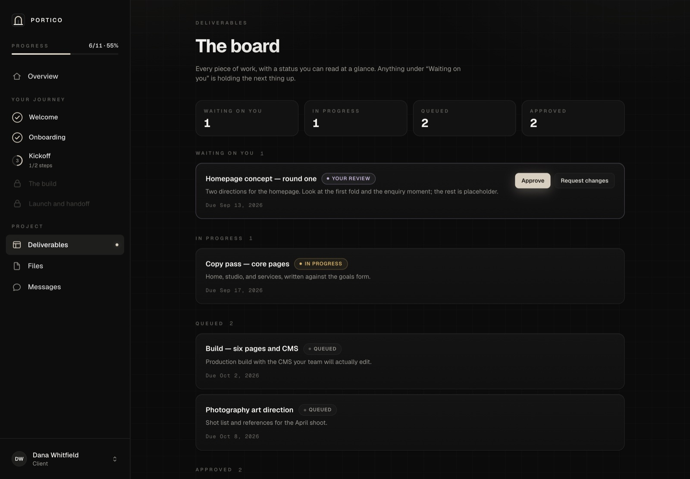
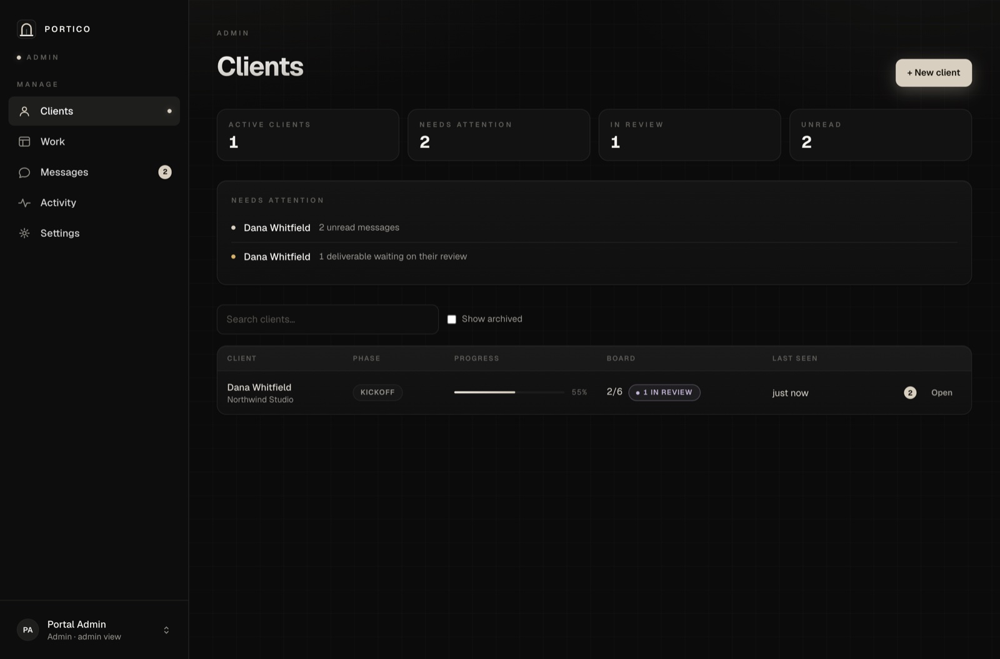
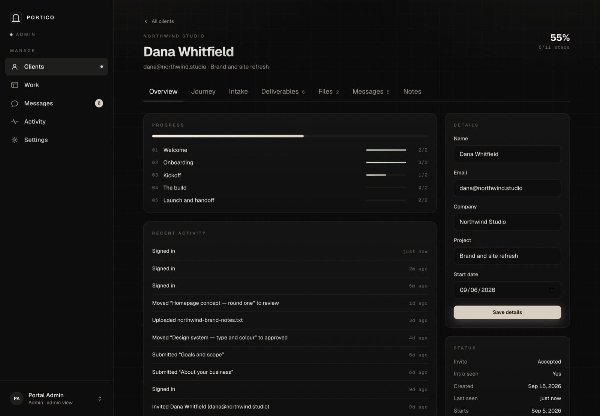

<p align="center">
  
</p>

<h1 align="center">Portico</h1>

<p align="center">
  <strong>The room your clients walk into.</strong><br>
  An open-source client portal for agencies, studios, and freelancers — onboarding,
  deliverables, files, and messages in one calm place.
</p>

<p align="center">
  
  
  
  
</p>

---

Most client work goes wrong in the gaps: the brief that lived in an email thread,
the file nobody could find, the fourth "just checking where we are" message.
Portico closes those gaps. Your client gets one link, one login, and one place
where everything about their project lives.

It runs entirely on your own machine or server. **One SQLite file, one uploads
folder, no third-party services, and no API keys** — not for auth, not for
storage, not for anything.

<p align="center">
  
</p>

## Try it in two minutes

```bash
git clone https://github.com/ufkrdev/portico.git
cd portico
npm install
npm run setup      # creates the database, the admin account, and a signing secret
npm run seed       # optional: a demo client with a half-finished project
npm run dev
```

Open **http://localhost:5800**.

### Sign in

`npm run setup` prints these, and `npm run seed` adds the client. They are
deliberately boring defaults for a local install:

| Role | Email | Password |
| --- | --- | --- |
| **Admin** | `admin@portico.dev` | `portico-admin` |
| **Client** (from `npm run seed`) | `dana@northwind.studio` | `portico-client` |

Sign in as the admin to run the business; sign in as Dana to see exactly what a
client sees. The admin can also switch to the client view from the account menu
in the bottom-left.

> **Change the admin password before this is reachable from the internet.**
> Account → Change password, or set `ADMIN_EMAIL` / `ADMIN_PASSWORD` before you
> run `npm run setup`. These credentials are published in this README precisely
> because they are meant to be replaced.

## What is in it

### For your client

- **A guided journey.** Five modules, eleven steps, unlocking in order so nobody
  starts the build on a half-filled brief.
- **Onboarding that sticks.** Intake forms that save as they type, with required
  answers enforced at submit rather than nagged at along the way.
- **A live deliverables board.** Queued → in progress → your review → approved.
  They approve or request changes in one click, and never have to ask where
  something is.
- **Files both ways.** Drag and drop, 25 MB a file, everything from the project
  in one list.
- **One message thread**, attached to the project, so whoever answers already has
  the context.
- **A handoff pack** at the end: every approved deliverable and every file, in one
  printable page they keep.

### For you

- **A client list that tells you what to do next** — unread messages, deliverables
  sitting in their court, invites nobody has accepted.
- **Client detail in seven tabs**: overview, journey, intake answers, deliverables,
  files, messages, and internal notes they never see.
- **One-time passwords.** Create a client, get a generated password and an invite
  message to paste. They choose their own the first time they sign in.
- **A work queue** across every client, ordered by what needs attention.
- **An activity log** of everything that has happened, grouped by day.
- **White-labelling from the UI** — name, tagline, accent colour, and support
  email live in the database, not in the code.

<table>
  <tr>
    <td width="50%"></td>
    <td width="50%"></td>
  </tr>
  <tr>
    <td width="50%"></td>
    <td width="50%"></td>
  </tr>
</table>

<p align="center"><a href="docs/screenshots.md">→ Every screen</a></p>

## No API keys, really

Portico has exactly one environment variable, and `npm run setup` generates it:

```
AUTH_SECRET=…   # signs the session cookie
```

That is the whole list. There is no Stripe, no Supabase, no S3, no Auth0, no
email provider, no AI provider. Authentication is bcrypt and a signed JWT in an
httpOnly cookie. Data is SQLite. Uploads are files on disk, served through a
route that checks the session on every request — nothing lands in `/public`.

If you want any of those services, they are yours to add. Nothing here assumes
them.

## Stack

| | |
| --- | --- |
| Framework | Next.js 15 (App Router, React 19, Turbopack) |
| Styling | Tailwind CSS 4 with a small token layer in `globals.css` |
| Data | SQLite via `better-sqlite3` |
| Auth | `bcryptjs` + `jose` (HS256 JWT in an httpOnly cookie) |
| Everything else | none |

## How it is laid out

```
src/
  app/
    page.tsx              the client's overview
    module/[slug]/        one journey module, step by step
    deliverables/  files/  messages/  account/
    admin/                clients, client detail, work, messages, activity, settings
    api/                  auth, progress, forms, files, messages, deliverables, admin
  components/
    PortalShell.tsx       the sidebar and layout for both views
    ModuleView.tsx        the step accordion
    steps/                one renderer per step type
  lib/
    journey.ts            the modules and steps  ← start here
    forms.ts              the intake forms
    docs.ts               the long-form content clients read
    brand.ts              defaults and the settings schema
    db.ts / schema.mjs    the database
scripts/                  setup, seed, reset
data/                     your database and uploads (gitignored)
```

## Making it yours

Everything an agency would want to change is in one of four files. There is no
admin CMS to fight and no migration to run — add a field, restart, done.

- **`src/lib/journey.ts`** — the modules and steps. Add one, remove one, reorder
  them. Nothing else hardcodes a step id.
- **`src/lib/forms.ts`** — the intake questions. Answers are stored as JSON, so a
  new field needs no migration.
- **`src/lib/docs.ts`** — the Markdown your clients read: how it works, the
  working agreement, the handoff note.
- **Admin → Settings** — name, tagline, accent colour, support email, and the
  booking link. Stored in your database, applied everywhere immediately.

[docs/CUSTOMISING.md](docs/CUSTOMISING.md) goes through each of these with
examples.

## Running it for real

Portico writes to the local filesystem, so it wants a host with a real disk: a
VPS, a Raspberry Pi, a Docker container with a volume, a Mac in a cupboard.
It will not work on a serverless platform with an ephemeral filesystem without
swapping the storage layer first.

```bash
npm run build
npm run start          # serves on :5800
```

Before you expose it:

1. `ADMIN_PASSWORD=… npm run setup`, or change the password from Account.
2. Keep `AUTH_SECRET` out of version control — `.env.local` is gitignored.
3. Put it behind HTTPS. The session cookie sets `secure` in production.
4. Back up `data/` — that directory *is* your portal.

## Security

- Passwords are bcrypt hashed (cost 10) and never logged.
- Sessions are HS256 JWTs in httpOnly, sameSite `lax` cookies, seven-day expiry.
- Middleware gates every route: no session means no page and no API.
- A client can only ever read their own rows — file downloads check ownership on
  every request, and `/admin/*` is closed to non-admins.
- Uploads are type- and size-limited and stored outside the web root under a
  generated name.

Found something? Open an issue, or email the address in `SECURITY.md` for
anything sensitive.

## Contributing

Issues and pull requests are welcome. [CONTRIBUTING.md](CONTRIBUTING.md) has the
short version: run it locally, keep the dependency list as short as it is, and
match the tone of the code around you.

## Licence

MIT. Do what you like with it, including running it for paying clients.
See [LICENSE](LICENSE).
# UGC
