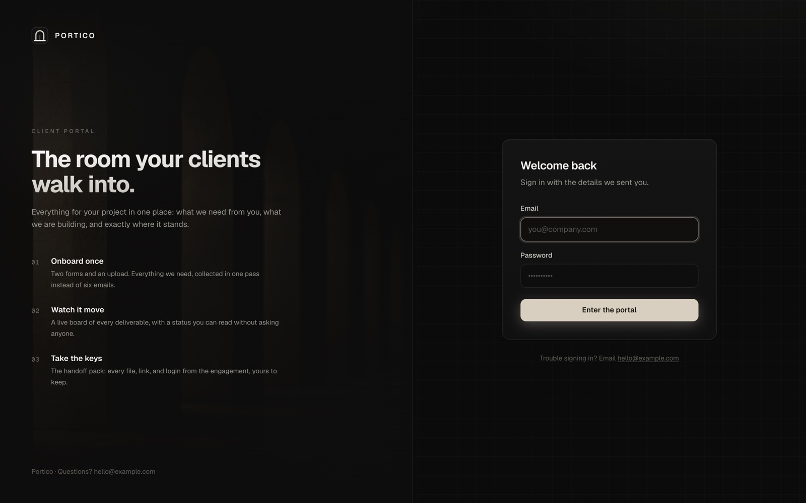
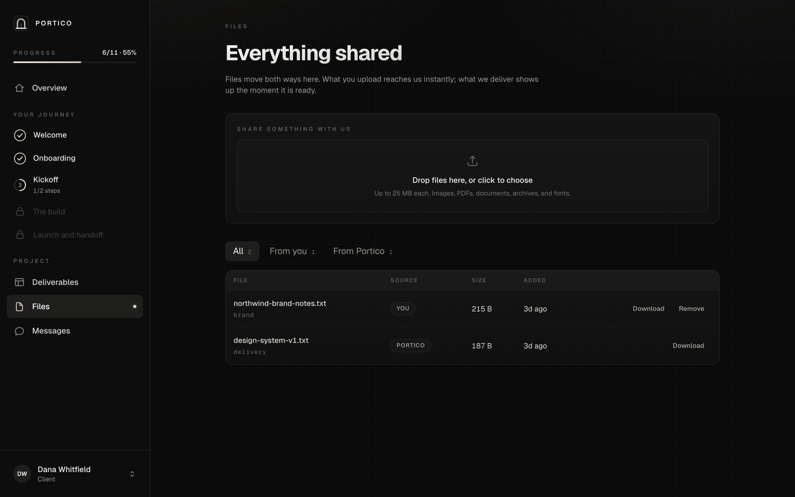
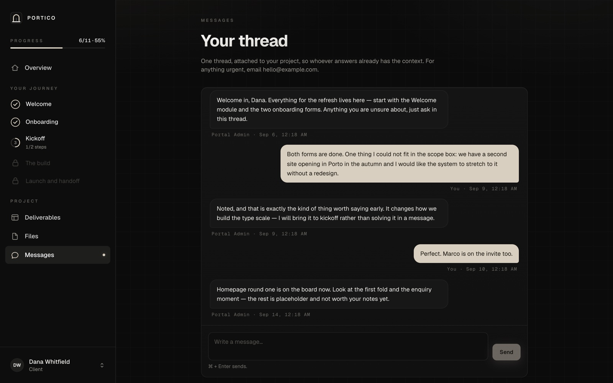
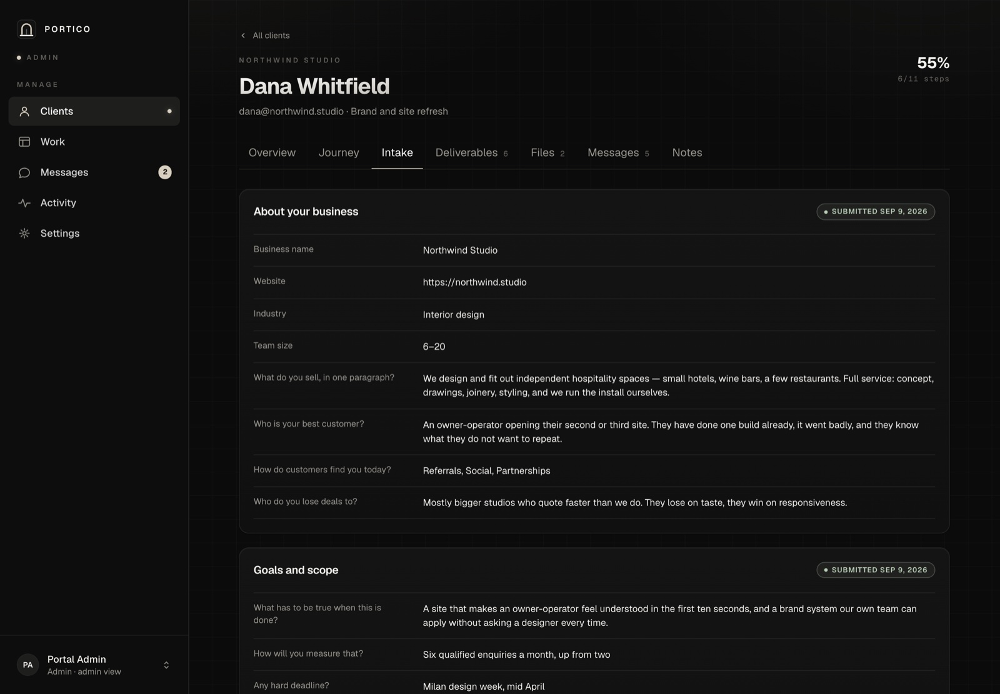
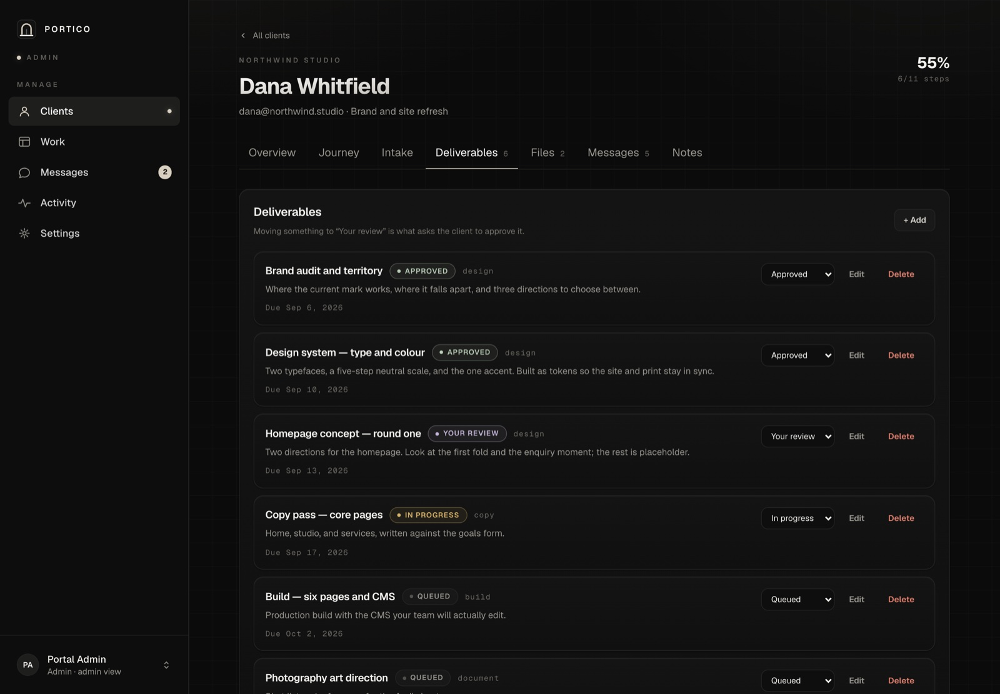
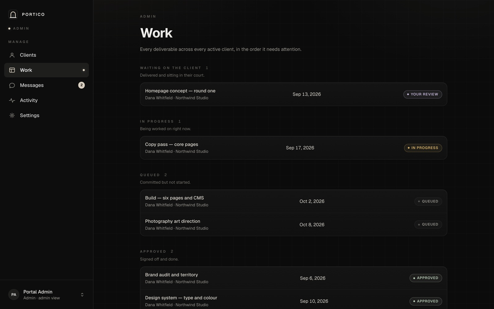
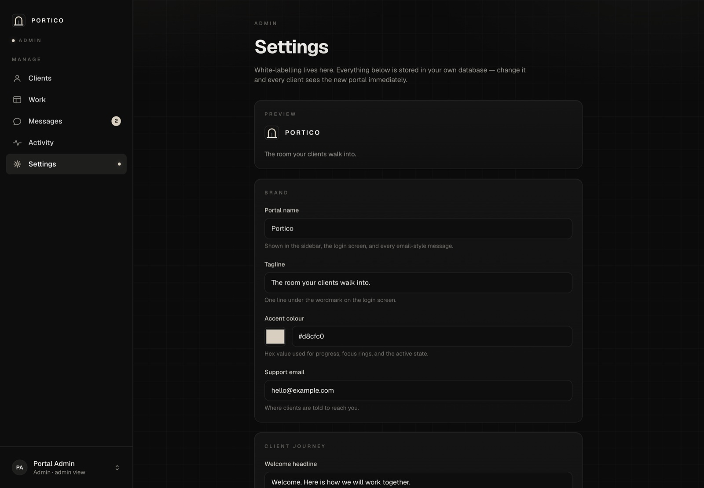

# Every screen

## The client

### Sign in

### Overview
Progress, anything waiting on them, the journey, and the latest from the board
and the thread.

### A journey module
Steps open one at a time. Forms save as they type and complete the step when
submitted.

### Deliverables
Grouped by status, with approve and request-changes on anything in their court.

### Files
Everything shared, both directions.

### Messages
One thread, attached to the project.

## The admin

### Clients
What needs attention, then everyone, with progress and board state at a glance.

### Client detail

### Their intake answers

### Their deliverables

### Work
Every deliverable across every client, ordered by what needs attention.

### Settings
White-labelling, stored in your database.

